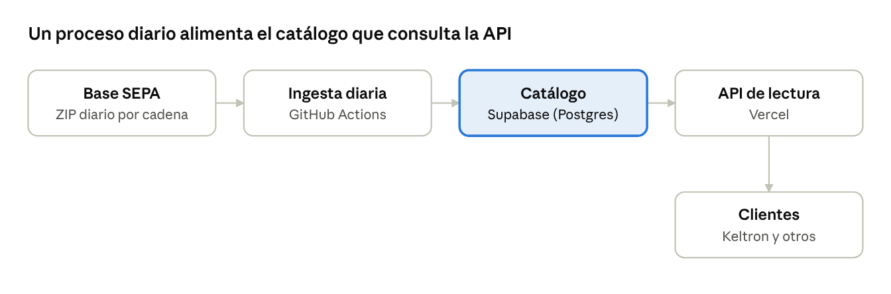
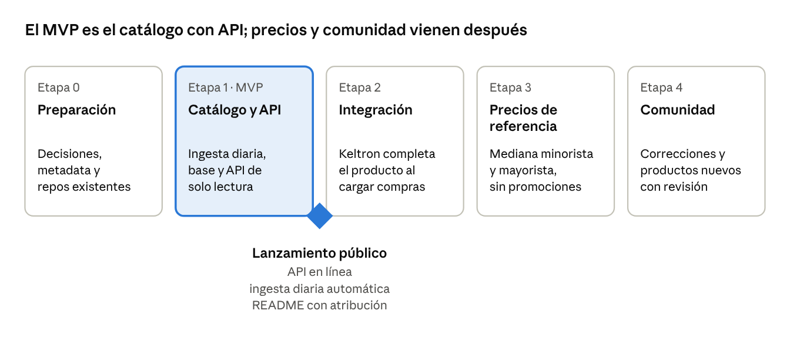

# BarrasAR

API abierta y gratuita de productos argentinos por código de barras (EAN). A partir de un código devuelve la ficha del producto: descripción, marca, presentación, categoría y un precio de referencia. Se alimenta todos los días con los datos públicos de SEPA (Precios Claros).

> Estado: en desarrollo. El plan completo está en [`docs/plan-del-proyecto.pdf`](docs/plan-del-proyecto.pdf).

## Cómo funciona



1. **Ingesta diaria (GitHub Actions)**: baja el ZIP del día del dataset SEPA, lee los ZIP de cada cadena, valida los códigos y arma una ficha por producto.
2. **Catálogo (Supabase / PostgreSQL)**: una sola tabla, `productos`, con una fila por código de barras.
3. **API de lectura (Vercel)**: consulta por código y búsqueda por texto.

## Usar la API

URL pública: **`https://barras-ar.vercel.app`**. Es solo de lectura, no necesita clave y acepta pedidos desde cualquier origen (CORS abierto).

| Endpoint | Para qué |
| --- | --- |
| `GET /products/{ean}` | Ficha de un producto por código (8 a 14 dígitos). 404 si no está, 400 si el código no es válido |
| `GET /products?q=alfajor milka&limit=5` | Búsqueda por texto. Cada palabra de `q` tiene que aparecer, completa o parcial (`alfaj mil` sirve). `limit` de 1 a 50 (por defecto 20), `offset` de 0 a 10000. La respuesta trae `has_more` para paginar |
| `GET /products/{ean}/related?limit=8` | Productos con códigos cercanos (mismo fabricante, a veces la misma línea). Sirve incluso para un código que no está en el catálogo |
| `GET /stats` | Cantidad de productos y día de los datos |
| `GET /health` | Estado del servicio |
| `GET /openapi.json` | Descripción OpenAPI completa |

### Ejemplo

`GET /products/7790040147720`

```json
{
  "ean": "7790040147720",
  "description": "GALLETITAS SURTIDO BAGLEY BOLSA X 400 GRS",
  "brand": "BAGLEY",
  "quantity": 400,
  "unit": "g",
  "category": null,
  "reference_price": { "median": 3850, "min": 2500, "max": 3985, "date": "2026-10-29" },
  "chains": 7,
  "first_seen": "2026-10-29",
  "last_seen": "2026-10-29",
  "source": "Precios Claros – Base SEPA (CC BY 4.0)"
}
```

| Campo | Qué es |
| --- | --- |
| `ean` | Código de barras, siempre de 13 dígitos. Los códigos cortos (EAN-8) llevan ceros delante: `0000077903785` es el EAN-8 `77903785` |
| `description`, `brand`, `category` | Como los informan los comercios (en su mayoría en mayúsculas). `brand` y `category` pueden ser `null` |
| `quantity`, `unit` | Presentación (`400`, `g`), cuando se pudo leer; si no, `null` |
| `reference_price` | `median` (precio típico), `min` y `max` entre las cadenas que lo informaron, y `date` del dato. Es `null` si no hay precio |
| `chains` | En cuántas cadenas se vende |
| `first_seen`, `last_seen` | Primer y último día en que apareció en los datos |
| `source` | Crédito de los datos; hay que mostrarlo (ver más abajo) |

El resto de los nombres de la API y del esquema también están en inglés; el contenido (descripciones, marcas) queda como lo informan los comercios.

### Autocompletar un producto en un punto de venta

El caso: quien carga la venta escribe "alfajor milka", el sistema sugiere productos con su precio de referencia y, al elegir uno, completa el código.

```bash
curl "https://barras-ar.vercel.app/products?q=alfajor%20milka&limit=5"
```

```json
{
  "data": [
    {
      "ean": "7622300457303",
      "description": "ALFAJOR CHOCO. BLANCO MOUSSE TRIPLE, MILKA, 55 g",
      "brand": "MILKA",
      "reference_price": { "median": 2375, "min": 1590, "max": 3200, "date": "2026-10-29" },
      "chains": 9
    }
  ],
  "limit": 5,
  "offset": 0,
  "has_more": true,
  "source": "Precios Claros – Base SEPA (CC BY 4.0)"
}
```

(La respuesta real trae todos los campos de la tabla de arriba; acá se muestran solo los que usa el autocompletado.)

Una receta que funciona bien:

1. Pedir sugerencias recién cuando hay **al menos 2 letras** y la persona dejó de escribir unos **300 ms**, con `limit=5`. Si el texto son solo dígitos de 8 a 14, es un código: ir directo a `GET /products/{ean}`.
2. Mostrar `description`, `brand` y `reference_price.median` como "precio de referencia".
3. Al elegir una sugerencia, completar el campo del código con `ean`.
4. Descartar la respuesta de un pedido viejo si ya hay otro más nuevo en camino.

La [app web](apps/web) de este repositorio hace esto: `apps/web/src/ui/search-box.ts`.

### Qué tener en cuenta

- **El precio es una referencia, no el precio del local.** `median` resume lo que informaron las cadenas incluidas en SEPA ese día. Sirve como orientación para cargar un precio, no para reemplazarlo.
- **Orden de los resultados:** por cuántas cadenas venden el producto y, a igualdad, por código. No hay ranking por parecido del texto.
- **Cobertura:** solo están los productos que las cadenas informaron el día de la ingesta. Un producto real puede faltar; en ese caso `GET /products/{ean}` da 404 y `/related` ofrece vecinos.
- **Límite de pedidos:** unos 60 por minuto por dirección IP (es un freno por instancia, no una cuota exacta). Varios puestos detrás de la misma conexión comparten ese cupo, así que conviene el retraso de 300 ms y pedir pocos resultados.
- **Actualización:** los datos se renuevan una vez por día y las respuestas se guardan hasta una hora en caché.
- **Licencia y crédito:** los datos son de [Precios Claros – Base SEPA](https://datos.produccion.gob.ar/dataset/sepa-precios) (CC BY 4.0). Toda aplicación que muestre estos precios debe indicar la fuente; cada respuesta trae el texto listo en `source`.
- **Disponibilidad:** es un servicio gratuito y sin garantía de disponibilidad.

## Números de un día real (jueves 29/10/2026)

- 76.581 códigos de barras válidos de 16 cadenas (Carrefour, DIA, Coto, Changomás, Jumbo/Disco/Vea, La Anónima, Cooperativa Obrera y otras).
- 14,3 millones de filas procesadas en unos 3 minutos.
- La tabla `productos` ocupa entre 25 y 28 MB con el índice de búsqueda.
- La regla que elige la descripción acertó en 93 de 100 productos revisados a mano.

## Hoja de ruta



## Contenido de esta carpeta

| Carpeta | Qué hay |
| --- | --- |
| `packages/ingest/` | Ingesta diaria en TypeScript: lee los ZIP de SEPA, arma la ficha de cada producto y carga el catálogo ([detalles](packages/ingest/README.md)) |
| `db/migrations/` | Migraciones SQL del catálogo |
| `apps/api/` | API de lectura con Hono, pensada para Vercel ([detalles](apps/api/README.md)) |
| `apps/web/` | App web móvil (PWA): escanear un código o buscar por nombre y ver los precios ([detalles](apps/web/README.md)) |
| `docs/` | Plan del proyecto (PDF) y diagramas |
| `docs/metadata/` | Especificación oficial de los archivos SEPA, minorista (Anexo II, Res. 678/2020) y mayorista |
| `prototipo/` | Prototipo en Python que se usó para medir. Referencia histórica: la versión en TypeScript lo reemplaza |
| `muestras/` | 1.000 productos de ejemplo ya procesados y la prueba de la regla de descripción |

## Desarrollo

Requiere Node 22 o superior. Guía para colaborar en [CONTRIBUTING.md](CONTRIBUTING.md).

```bash
npm install
npm test            # tests
npm run typecheck   # tipos
npm run lint        # ESLint
npm run format      # Prettier
```

## Fuente de los datos y licencia

Datos: [Precios Claros – Base SEPA](https://datos.produccion.gob.ar/dataset/sepa-precios), Subsecretaría de Defensa del Consumidor y Lealtad Comercial. Licencia [CC BY 4.0](https://creativecommons.org/licenses/by/4.0/deed.es). Datos procesados y modificados por BarrasAR (limpieza, unificación y normalización).

Los datos son los que informan los comercios y pueden contener errores. Este proyecto no está respaldado por el Gobierno argentino. Las marcas mencionadas pertenecen a sus titulares.

- Código: MIT.
- Datos que devuelve la API: CC BY 4.0, la misma licencia que la fuente.
